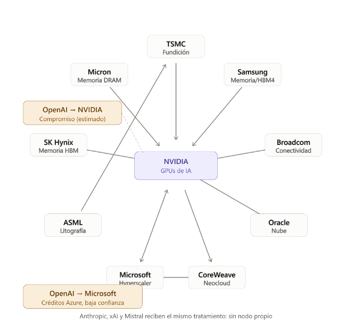

# Modelado funcional de la propagación de shocks en redes de dependencias empresariales mediante relaciones estructurales y atención sobre grafos

## Take aways
- Las empresas tecnológicas no operan como unidades independientes, sino como nodos de redes de suministro, financiamiento, propiedad e infraestructura.
- Un shock localizado puede transmitirse hacia clientes, proveedores y socios con intensidades diferentes.

## Caso de Estudio
_La fabricación de aceleradores, la disponibilidad de memoria de alto ancho de banda (HBM), la capacidad de fundición, el equipamiento litográfico, la infraestructura de nube y la demanda de grandes laboratorios de IA forman una red de dependencias técnicas y económicas._

## Pregunta de Investigación
_¿un modelo que aprende la fuerza de las relaciones entre empresas mejora la estimación del impacto de un evento sobre las demás empresas de la red, en comparación con pesos estructurales fijos y con un modelo sin red?_
### Sub preguntas
1. ¿Qué tipos de relación aportan mayor señal?
2. ¿Cómo varían los pesos entre períodos normales y anormales?
3. ¿Qué sensibilidad presenta el resultado ante errores u omisiones en la topología?

## Objetivo
Estimar cómo un shock se propaga sobre una red empresarial y determinar si la intensidad de las relaciones debe fijarse estructuralmente o puede aprenderse a partir de evidencia observada.

### Enfoques
- Un modelo base sin propagación en red (M0)
- Un modelo con pesos estructurales fijos derivados de variables financieras observables (M1)
- Un modelo con pesos aprendidos mediante una Graph Attention Network (GAT), (M2)
## Antecedentes y Trabajos Relacionados
- Acemoglu et al. &rarr; la topología de las relaciones input-output condiciona la transmisión de perturbaciones y las conexiones indirectas permiten efectos de cascada más allá de los clientes inmediatos.
- Barrot y Sauvagnat &rarr; Aportan evidencia empirica: shocks idiosincráticos sufridos por proveedores pueden producir pérdidas de producción y de valor de mercado en sus clientes, con efectos más intensos cuando los insumos son específicos.
- Estos resultados justifican representar el sistema como una red y no como un conjunto de observaciones independientes
- Cohen y Frazzini &rarr; estudian relaciones económicas cliente-proveedor y encuentran evidencia de difusión gradual de información entre firmas conectadas. Su conclusion: proporciona una conexión entre dependencia económica y respuesta bursátil observable: si un evento afecta a un nodo, los retornos de empresas relacionadas pueden contener información sobre la intensidad con la que el shock se transmite.

### Aprendizaje Sobre Grafos
- GNN (Graph Neural Networks) &rarr; extienden el aprendizaje profundo a dominios en los que las observaciones están conectadas por relaciones explícitas
- Graph Convolutional Network &rarr; aprende representaciones de nodos combinando información propia y de sus vecinos 
- Graph Attention Networks &rarr; introducen un mecanismo de atención que permite asignar importancias diferentes a los vecinos durante la agregación.  <b>De aca se deriva que dos relaciones presentes en la topología no necesariamente transmiten un shock con la misma intensidad.</b>
- Feng et al. proponen Relational Stock Ranking, incorporando relaciones entre acciones mediante convolución temporal sobre grafos y evaluando el enfoque sobre NYSE y NASDAQ 

### Estudio de eventos
- Es una metodología estándar para medir la reacción del valor de una firma alrededor de un acontecimiento identificable. 
- MacKinlay sistematiza el enfoque y sus principales decisiones metodológicas, incluyendo la definición de ventanas, el cálculo de retornos esperados y la obtención de retornos anormales 

### Programación funcional como soporte del modelo
Hughes destaca la modularidad derivada de la composición y de las funciones de orden superior. 
Para una simulación por pasos, esta propiedad permite expresar cada transición como una función $Estado_t \rightarrow Estado_{t+1}$}. 
La consecuencia de esto es _dados el mismo grafo, pesos, shock y número de iteraciones, el resultado del núcleo de propagación es determinista y reproducible._

## Formulacion Del Problema
Sea $G = (V, E, L)$ un grafo dirigido multicapa.  
Donde:  
$V$ representa empresas públicas 
$E$ las relaciones dirigidas entre ellas  
$L$ el conjunto de capas de relación 

El diseño actual considera tres capas: <b>comercial</b>, <b>capital</b> y <b>colateral/infraestructura</b>.
La dirección de una arista expresa el sentido de la dependencia relevante para la propagación. Para cada nodo _i_ se define:
1. Un vector de características financieras $x_i$ que incluye:  
    - Ingresos totales $I_i$
    - Capitalización de mercado $M_i$
    - Deuda total $D_i$
2. Para cada arista i &rarr; j:
    - $V_{ij}$ volumen de ventas asociado a la contraparte
    - $E_{ji}$ valor de la participación accionaria relevante
	- $G_{ij}$ valor de infraestructura o colateral asociado a la relación

La disponibilidad real de estas variables no es uniforme.
Nota: El alcance cuantitativo se restringe a empresas públicas con información financiera auditable.

### Peso estructural de una relación
El modelo estructural resume tres dimensiones normalizadas mediante una combinación convexa. Para una arista i &rarr; j
$$R_{ij} = 100 \cdot \min \left( 1, w_c \cdot \frac{V_{ij}}{I_i} + w_a \cdot \frac{E_{ji}}{M_j} + w_f \cdot \frac{G_{ij}}{D_j} \right)$$
Con w_c + w_a + w_f = 1. 
En el prototipo se utilizan w_c = 0,50, w_a = 0,30 y w_f = 0,20. como parametrización inicial. Estos valores deben interpretarse como hipótesis de modelado y no como coeficientes universalmente validados.

### Propagación Discreta
Sea $s_i^{(t)}$ el impacto acumulado en el nodo $i$ en el paso $t$ y $p_{ji}$ el peso de la arista j &rarr; i expresado en [0,1]. La propagación acumulativa puede escribirse como:
$$s_i^{(t+1)} = s_i^{(t)} + \sum_{j : (j,i) \in E} p_{ji} \cdot s_j^{(t)}$$
Esta formulación reproduce el comportamiento del prototipo actual

## Metodologia Propuesta
### Construccion del grafo y fuentes
La construcción del dataset debe privilegiar fuentes públicas, programáticas y reproducibles. Los estados financieros trimestrales y anuales de compañías estadounidenses pueden obtenerse de SEC EDGAR. Los precios diarios pueden provenir de fuentes de mercado reproducibles como Stooq o, cuando las condiciones de uso lo permitan, Yahoo Finance. Para controlar el movimiento general del sector se propone utilizar el Philadelphia Semiconductor Index (SOX) como referencia en el modelo de mercado.  
Como se aprecia en la Figura 1, el grafo inicial incluye diez compañías públicas del ecosistema de semiconductores e infraestructura de IA: NVIDIA, TSMC, SK Hynix, Micron, Samsung, Microsoft, Oracle, CoreWeave, ASML y Broadcom

### Evento y diseño temporal
Se toma como evento ancla una revisión pública de las expectativas sobre los precios de memoria ocurrida el 2 de febrero de 2026. La elección de un evento debe satisfacer dos condiciones: una fecha identificable y un contenido informativo suficientemente externo al comportamiento individual de una única firma. El prototipo define una ventana de estimación de 120 días hábiles que finaliza diez días antes del evento y una ventana de evento [-2,+10]. Un estudio de eventos mide la asociación temporal entre el acontecimiento y movimientos anormales aunque la presencia de noticias concurrentes puede contaminar la ventana.

### Retornos anormales
Para cada empresa $i$, el retorno esperado puede estimarse mediante un modelo de mercado de un factor:
$$\mathbb{E}[R_{i,t}] = \alpha_i + \beta_i R_{m,t}$$
Y el retorno anormal se define como :
$$AR_{i,t} = R_{i,t} - (\alpha_i + \beta_i R_{m,t})$$

El retorno anormal acumulado para una ventana $[\tau_1, \tau_2]$ es
$$CAR_i(\tau_1, \tau_2) = \sum_{t=\tau_1}^{\tau_2} AR_{i,t}$$
El CAR constituye una señal observable con la que comparar el impacto relativo simulado por la red.

### Modelo con atencion
En este modelo cada nodo posee un embedding $h_i$ y la importancia de la relación i &rarr; j se calcula mediante un coeficiente de atención. Siguiendo la formulación general de GAT:
$$e_{ij} = \text{LeakyReLU}\left(\mathbf{a}^T [\mathbf{W}h_i \parallel \mathbf{W}h_j]\right)$$
$$\alpha_{ij} = \frac{\exp(e_{ij})}{\sum_{k \in \mathcal{N}(i)} \exp(e_{ik})}$$

El coeficiente $α_ij$ reemplaza la ponderación estática durante la agregación. De este modo, la topología puede mantenerse mientras cambia la intensidad efectiva de las relaciones según los atributos de los nodos y aristas. Para incorporar las tres capas del grafo, una extensión natural consiste en concatenar características de arista al cálculo de atención o utilizar atención específica por tipo de relación.

El entrenamiento se plantea minimizando la discrepancia entre impacto simulado y señal observada. 
Una formulación básica es: $$L = \sum_i (\hat{s}_i - y_i)^2$$, donde $\hat{s}_i$ es el impacto normalizado predicho por la propagación y $y_i$ una transformación normalizada del CAR

## Implementación funcional
La implementación en Haskell materializa el modelo como datos inmutables y transformaciones puras. El grafo se representa mediante un mapa de adyacencia que asocia cada empresa con sus atributos financieros y una lista de conexiones. Los atributos de nodos y aristas se expresan mediante tipos algebraicos y registros. Esta representación permite separar el dominio —empresa, relación, confianza, evento— de los algoritmos que lo procesan.  
La decisión central es que la propagación no conoce el origen de los pesos. Recibe una matriz de relaciones y un estado de impacto, y devuelve un estado nuevo. Por ello, el mismo núcleo puede utilizar pesos estructurales o coeficientes aprendidos.  
La evolución temporal se expresa mediante un plegado funcional sobre una secuencia de pasos. No existe un objeto Empresa cuyo estado interno sea mutado en cada iteración; cada paso produce un nuevo mapa. Esta propiedad facilita pruebas unitarias y reproducción exacta de una corrida a partir de sus entradas. La elección no implica que la orientación a objetos sea incapaz de ofrecer reproducibilidad, sino que el paradigma funcional hace explícita por construcción una disciplina adecuada para este tipo de simulación.

## Diseño experimental y criterios de evaluación
La evaluación debe distinguir capacidad descriptiva, capacidad predictiva y robustez. El objetivo primario es determinar si incorporar la red y, posteriormente, aprender sus pesos reduce el error respecto del baseline.  
Para responder de forma válida a la pregunta principal se requieren múltiples eventos. Un único shock permite un estudio de caso, pero no proporciona suficientes observaciones independientes para sostener que los pesos aprendidos generalizan. Por ello, el evento ancla debe considerarse una primera validación; el protocolo completo debe incorporar eventos adicionales comparables y mantener una separación temporal estricta entre entrenamiento, validación y prueba

| Dimensión | Métrica/prueba | Interpretación |
| :--- | :--- | :--- |
| **Ajuste** | MAE y RMSE entre impacto normalizado y CAR normalizado | Menor error indica mayor correspondencia cuantitativa. |
| **Dirección** | Exactitud de signo / *balanced accuracy* | Evalúa si se reproduce correctamente el sentido del impacto. |
| **Orden relativo** | Correlación de Spearman | Evalúa si el modelo ordena correctamente las firmas por intensidad. |
| **Ablación** | Eliminar capas comercial, capital o colateral | Mide qué tipo de relación aporta señal incremental. |
| **Topología** | Eliminar o perturbar aristas | Mide sensibilidad a omisiones y errores del grafo. |
| **Temporal** | Ventanas alternativas y partición cronológica | Evalúa estabilidad y reduce riesgo de fuga de información. |

## Estado del prototipo y resultados disponibles
El prototipo actual permite ejecutar de extremo a extremo dos de los tres modelos conceptuales: M0 y M1. Implementa el baseline sin red, el cálculo de $R_{ij}$, la generación de la matriz de relaciones, la propagación por pasos y las funciones básicas asociadas al estudio de eventos. También define la firma del componente de atención, pero esta continúa siendo un placeholder que utiliza el peso estructural.
Por este motivo, no es metodológicamente correcto reportar una superioridad de M2 ni comparar errores de los tres modelos. Del mismo modo, los valores financieros incluidos en el dataset de ejemplo son explícitamente datos de desarrollo y no observaciones extraídas de SEC EDGAR. El resultado científico disponible en esta etapa es, por tanto, la formalización reproducible del experimento y la implementación del núcleo funcional, no una conclusión empírica sobre la eficacia de la GAT.

## Conclusiones y trabajo futuro
- El uso de Haskell se concentra en el núcleo determinista del modelo. La inmutabilidad del grafo, la representación mediante tipos algebraicos y la propagación como función pura permiten que cada corrida sea una transformación reproducible de entradas en salidas
- El prototipo demuestra la viabilidad de esta arquitectura, pero todavía no permite responder empíricamente la pregunta principal. La GAT no ha sido entrenada y los datos de ejemplo deben sustituirse por observaciones verificables. Por tanto, la conclusión actual no es que los pesos aprendidos sean superiores, sino que se ha establecido un protocolo explícito para someter esa hipótesis a prueba
- El trabajo futuro inmediato comprende: automatizar la extracción y armonización de datos financieros; construir un conjunto de múltiples eventos; estimar retornos anormales con parámetros calibrados en la ventana de estimación; implementar y entrenar la GAT; realizar ablaciones por capa; incorporar perturbaciones controladas de topología; y estudiar variantes dinámicas con retardos y decaimiento